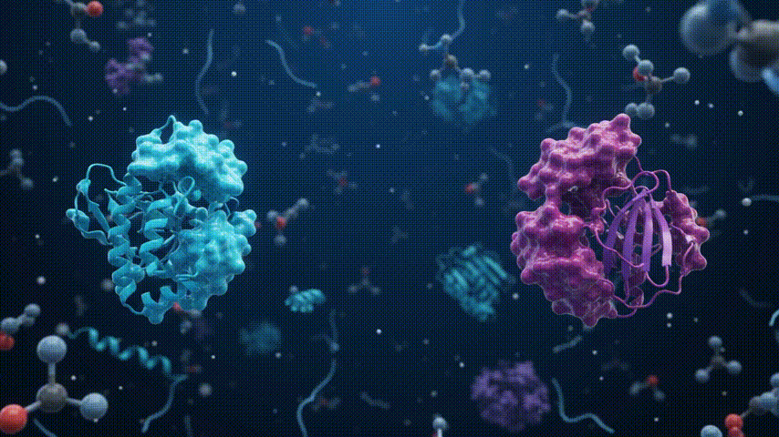
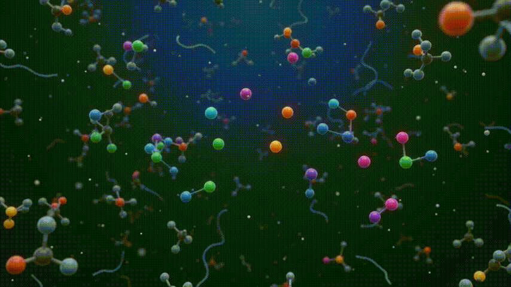

# Protein-Protein Interaction (PPI) Networks

A Protein-Protein Interaction (PPI) network is a graphical representation of the physical contacts between proteins within a cell, organism, or specific biological context. In this network model, proteins are represented as nodes (vertices), and interactions between them are represented as edges (links). The complete set of all PPIs in a given system is referred to as the interactome.

<table>
  <tr>
    <td align="center"></td>
    <td align="center"></td>
  </tr>
</table>

### ⏳ Script will be loading soon.....
